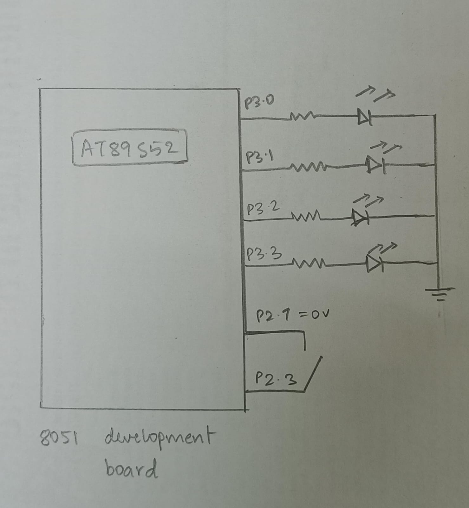

# CAT3 – Timer-Based LED Pattern Generator and Button Interrupt Controller

| | |
|---|---|
| **EXP** | CAT3 |
| **DATE** | 27/07/2026 |
| **NAME OF EXP** | Timer-Based LED Pattern Generator and Button Interrupt Controller |

---

## Hardware Setup / Platform

- **Development Board:** 8051 Development Board
- **Microcontroller:** AT89S52
- **CPU Core:** 8051-compatible 8-bit microcontroller core
- **Programming Environment:** Keil µVision
- **Programming Language:** Embedded C
- **External Components:** Four LEDs, current-limiting resistors and a push button

### Pin Connections

| Signal | Pin | Function |
|---|---|---|
| LED1 | P3.0 | Output |
| LED2 | P3.1 | Output |
| LED3 | P3.2 | Output |
| LED4 | P3.3 | Output |
| Button drive line | P2.7 | Driven LOW |
| Button sense line | P2.3 | Reads LOW when the button is pressed (active LOW) |

---

## Task No

1. Configure four LEDs as digital outputs using direct GPIO register access.
2. Configure a push button as a digital input.
3. Implement four LED operating modes:
   - Mode 1 – Running LED Pattern
   - Mode 2 – 4-bit Binary Counter
   - Mode 3 – Alternating LED Pattern
   - Mode 4 – All LED Flash
4. Detect button presses and advance to the next operating mode.
5. Ensure one physical press produces one mode change by waiting for the button to be released.

---

## Circuit Diagram



Four LEDs are connected to P3.0 – P3.3 of the AT89S52. A push button is connected between P2.7 and P2.3. Pressing the button pulls P2.3 LOW, and the program uses this to switch to the next mode.

---

## Core Logic / Pseudocode / Code Base

The experiment demonstrates bare-metal programming of the AT89S52 microcontroller without using Arduino APIs, HAL libraries or RTOS services.

The LEDs and the push button are accessed using `sbit` declarations. A global variable `count` (0 – 3) stores the current mode. Each mode is a separate function that keeps running while `count` equals its mode number.

### Modes

| Mode | count | Name | Behaviour |
|---|---|---|---|
| 1 | 0 | Running LED | LED1 → LED2 → LED3 → LED4, one LED ON at a time |
| 2 | 1 | 4-bit Binary Counter | Binary values 0000 to 1111 are shown on the four LEDs |
| 3 | 2 | Alternating LEDs | LED2 + LED4 ON, then LED1 + LED3 ON |
| 4 | 3 | All LED Flash | All LEDs ON, then all LEDs OFF |

### Working

1. Declare the LEDs (P3.0 – P3.3) and the button lines (P2.7, P2.3) using `sbit`.
2. Drive P2.7 LOW and set P2.3 HIGH so it can be read as an input.
3. Start with `count = 0` (Mode 1).
4. In `main()`, call the mode function that matches `count`.
5. Each mode shows its LED pattern and calls `delay()` between steps.
6. Inside `delay()`, the button on P2.3 is checked continuously.
7. When a press is detected, `count` increases by 1 (wrapping from 3 back to 0), the program waits for the button to be released, and `delay()` returns immediately.
8. The running mode then sees that `count` has changed and exits, and `main()` starts the next mode.

### Pseudocode

```
START

Set P2.7 LOW
Set P2.3 HIGH (input)
count = 0

WHILE (1)
    SWITCH (count)
        0: Run Mode 1 (Running LED)
        1: Run Mode 2 (Binary Counter)
        2: Run Mode 3 (Alternating LEDs)
        3: Run Mode 4 (All LED Flash)
END WHILE


DELAY()
    FOR i = 0 TO 499
        FOR j = 0 TO 499
            IF button pressed (P2.3 == LOW)
                count = (count + 1) MOD 4
                Wait until button is released
                RETURN
            END IF
        END FOR
    END FOR
```

### Key Observations

- The button is polled inside the delay loop, so no interrupts are used and the mode changes without waiting for the pattern to finish.
- Waiting for the button release after a press prevents one press from changing the mode more than once.
- No separate debounce delay is used.
- Each mode function checks `count` after every `delay()` call and exits as soon as the mode changes.

### Source Code: `main.c`

The complete implementation is available in the source file included in this folder: [main.c](main.c)

---

## Inference

The experiment demonstrates register-level GPIO control using the AT89S52 microcontroller. Four LEDs are controlled through Port 3, while a push button connected to Port 2 is used to change the operating mode.

The program demonstrates four different LED patterns: sequential LED running, binary counting, alternating LEDs and simultaneous LED flashing. A software delay function is used to control the timing of the LED patterns.

The implementation demonstrates direct hardware control without using Arduino APIs, HAL libraries or RTOS services. The current implementation uses button polling and software delays rather than hardware timer interrupts or an external button interrupt. The delays are uncalibrated software loops, and the exact timing of the patterns was not verified.
