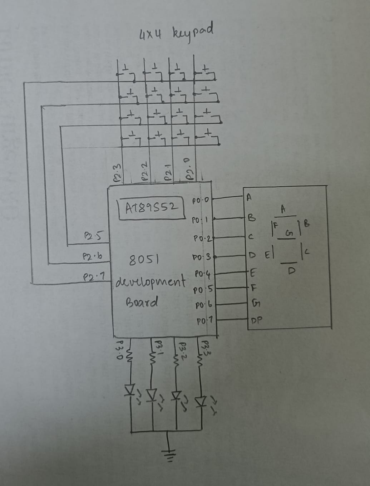

# CAT4 – Human-Machine Interface using Matrix Keypad, LEDs, and Seven-Segment Display

| | |
|---|---|
| **EXP** | CAT4 |
| **DATE** | 03/08/2026 |
| **NAME OF EXP** | Human-Machine Interface using Matrix Keypad, LEDs, and Seven-Segment Display |

---

## Hardware Setup / Platform

- **Development Board:** 8051 Development Board
- **Microcontroller:** AT89S52
- **CPU Core:** 8051-compatible 8-bit microcontroller core
- **Programming Environment:** Keil µVision
- **Programming Language:** Embedded C
- **External Components:** Matrix keypad, seven-segment display, four LEDs with current-limiting resistors

### Pin Connections

| Signal | Pin | Function |
|---|---|---|
| Keypad Row 1 | P2.7 | Output (row drive) |
| Keypad Row 2 | P2.6 | Output (row drive) |
| Keypad Row 3 | P2.5 | Output (row drive) |
| Keypad Column 1 | P2.3 | Input (column sense) |
| Keypad Column 2 | P2.2 | Input (column sense) |
| Keypad Column 3 | P2.1 | Input (column sense) |
| Keypad Column 4 | P2.0 | Input (column sense) |
| Seven-segment outputs | P0.0 – P0.6 | Segments a – g |
| Decimal point | P0.7 | Output |
| LED1 | P3.0 | Output |
| LED2 | P3.1 | Output |
| LED3 | P3.2 | Output |
| LED4 | P3.3 | Output |

### Keypad Layout

| | Col 1 (P2.3) | Col 2 (P2.2) | Col 3 (P2.1) | Col 4 (P2.0) |
|---|---|---|---|---|
| **Row 1 (P2.7)** | 1 | 2 | 3 | 4 |
| **Row 2 (P2.6)** | 5 | 6 | 7 | 8 |
| **Row 3 (P2.5)** | 9 | 0 | – | – |

---

## Task No

1. Configure and scan a matrix keypad to identify the pressed key.
2. Display the corresponding key value on the seven-segment display.
3. Control four LEDs according to the pressed key.
4. Implement a running LED pattern using key 5.
5. Implement an alternating LED pattern using key 6.
6. Implement a 4-bit binary counter from 0 to 15 using key 7.
7. Implement an all-LED blinking pattern using key 8.
8. Turn OFF all LEDs using key 9.
9. Reset the system using key 0.

---

## Circuit Diagram



The matrix keypad is connected to Port 2, the seven-segment display to Port 0, and the four LEDs to P3.0 – P3.3 of the AT89S52.

---

## Core Logic / Pseudocode / Code Base

The program implements a keypad-controlled human-machine interface using the AT89S52 microcontroller. The matrix keypad is the input device, the seven-segment display shows the pressed key, and four LEDs show the selected operation.

The port pins are accessed using `sbit` declarations. The pressed key is stored in the global variable `key` (`10` means no key pressed).

### Key Operations

| Key | Operation | Behaviour |
|---|---|---|
| 1 | LED1 ON | LED1 ON, other LEDs OFF |
| 2 | LED2 ON | LED2 ON, other LEDs OFF |
| 3 | LED3 ON | LED3 ON, other LEDs OFF |
| 4 | LED4 ON | LED4 ON, other LEDs OFF |
| 5 | Running LED | LED1 → LED2 → LED3 → LED4, one LED ON at a time |
| 6 | Alternating LEDs | LED2 + LED4 ON, then LED1 + LED3 ON |
| 7 | Binary Counter | Binary values 0000 to 1111 shown on the four LEDs |
| 8 | All LED Blink | All LEDs ON, then all LEDs OFF, repeatedly |
| 9 | LED OFF | All LEDs OFF |
| 0 | Reset | Key state cleared, all LEDs OFF, display shows 0 |

### Seven-Segment Patterns

The patterns used in the code are for a common-cathode display (segment ON = 1).

| Digit | P0 value | Digit | P0 value |
|---|---|---|---|
| 0 | 0x3F | 5 | 0x6D |
| 1 | 0x06 | 6 | 0x7D |
| 2 | 0x5B | 7 | 0x07 |
| 3 | 0x4F | 8 | 0x7F |
| 4 | 0x66 | 9 | 0x6F |

### Working

1. Initialize all four LEDs to OFF and clear the seven-segment display.
2. Wait in a loop, scanning the keypad, until a key is pressed.
3. Scan the keypad by driving the rows LOW one at a time and checking the column inputs.
4. Identify the pressed key and store it in `key`.
5. Convert the key into its seven-segment pattern and show it on Port 0.
6. Use a `switch` statement to run the LED function for the pressed key.
7. Inside every `delay()` call, keep scanning the keypad. If a different key is detected, the delay returns immediately.
8. The running mode then exits, and the main loop displays the new key and starts its mode.

### Pseudocode

```
START

INITIALIZE:
    Set all four LEDs OFF
    Clear the seven-segment display
    key = 10 (no key pressed)

REPEAT FOREVER:

    WAIT until a key is pressed (scan keypad)

    DISPLAY:
        Convert key to seven-segment pattern
        Show the digit

    SELECT OPERATION USING KEY:

        IF key is 1-4:
            Turn ON the matching LED
            Turn OFF the other LEDs

        ELSE IF key is 5:
            Run the running LED pattern
            Scan keypad during delays

        ELSE IF key is 6:
            Run the alternating LED pattern
            Scan keypad during delays

        ELSE IF key is 7:
            Show binary count 0 to 15 on the LEDs
            Scan keypad during delays

        ELSE IF key is 8:
            Blink all four LEDs
            Scan keypad during delays

        ELSE IF key is 9:
            Turn OFF all four LEDs

        ELSE IF key is 0:
            key = 10
            Turn OFF all four LEDs
            Display zero

END REPEAT
```

### Key Observations

- The keypad is scanned inside the delay loop, so the mode changes immediately without waiting for the pattern to finish.
- The selected key stays active until a different key is pressed.
- No separate debounce routine is used.
- Interrupts and hardware timers are not used.

### Source Code: `main.c`

The complete implementation is available in the source file included in this folder: [main.c](main.c)

---

## Inference

The experiment demonstrates the implementation of a basic human-machine interface using the AT89S52 microcontroller. A matrix keypad is used to provide user input, a seven-segment display shows the pressed key, and four LEDs provide visual feedback based on the selected operation.

The program demonstrates individual LED control, sequential LED running, alternating LED patterns, binary counting, simultaneous LED blinking and system reset functionality.

The implementation uses direct port-pin access and Embedded C without Arduino APIs, HAL libraries or RTOS services. Keypad scanning and LED operations are implemented using separate functions and software delays. The delays are uncalibrated software loops, and the exact timing of the patterns was not verified.
