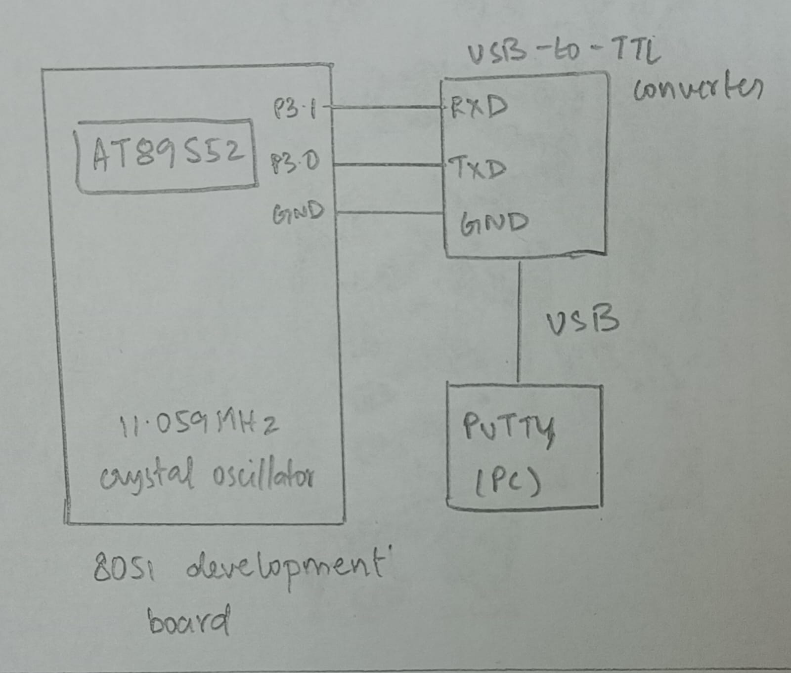

# CAT6 – Task 1: UART Initialization and Character Transmission

|                 |                                                |
| --------------- | ---------------------------------------------- |
| **EXP**         | CAT6 – Task 1                                  |
| **DATE**        | 17/08/2026                             |
| **NAME OF EXP** | UART Driver and Serial Debugging               |

---

## Hardware Setup / Platform

- **Development Board:** 8051 Development Board
- **Microcontroller:** AT89S52
- **CPU Core:** 8051-compatible 8-bit microcontroller core
- **Crystal Frequency:** 11.0592 MHz
- **Programming Environment:** Keil µVision
- **Programming Language:** Embedded C
- **UART Mode:** Mode 1 (8-bit asynchronous serial communication)
- **Baud Rate:** 9600 bps
- **Data Bits:** 8
- **Stop Bits:** 1
- **Parity:** None
- **Transmit Pin:** P3.1 (TXD)
- **Timer Used:** Timer 1
- **Timer Mode:** Mode 2 (8-bit auto-reload)
- **Serial Interface:** USB-to-TTL Converter
- **Terminal Software:** PuTTY

### Pin Connections

| **Signal** | **AT89S52 Pin** | **USB-to-TTL Converter** |
| ---------- | -------------- | ------------------------ |
| TXD        | P3.1           | RXD                      |
| GND        | GND            | GND                      |

The USB-to-TTL converter is connected to the PC through USB. The transmitted serial data is displayed in PuTTY through the corresponding COM port.

---

## Task No

**Task 1 – UART Initialization and Character Transmission**

Configure the AT89S52 UART for 9600-8-N-1 asynchronous serial communication and continuously transmit the message `Hello from 8051` to a PC terminal using a USB-to-TTL converter.

---

## Circuit Diagram



The circuit consists of the AT89S52 microcontroller, USB-to-TTL serial converter and PC terminal.

The TXD pin (P3.1) of the microcontroller is connected to the RXD pin of the USB-to-TTL converter. The grounds of both devices are connected together to establish a common reference.

The USB-to-TTL converter transfers the serial data to the PC through USB, where it is displayed using PuTTY.

---

## Core Logic / Pseudocode / Code Base

### Working Principle

The UART is configured in Mode 1, which supports 8-bit asynchronous serial communication with a variable baud rate.

Timer 1 is configured in Mode 2 (8-bit auto-reload mode) to generate the baud-rate timing. With an 11.0592 MHz crystal and a reload value of `TH1 = 0xFD`, the UART operates at 9600 baud when the SMOD bit is cleared.

The `SBUF` register is used to load each character for transmission. Once a character has been transmitted, the `TI` (Transmit Interrupt) flag becomes 1. The program checks this flag through polling and clears it before transmitting the next character.

The message is stored in a character array. Its length is calculated using `sizeof(message) - 1`, excluding the null terminator. A loop transmits each character sequentially, and the process repeats continuously.

### UART Configuration

| **Register / Bit** | **Configuration** | **Purpose** |
| ------------------ | ----------------- | ----------- |
| PCON               | `0x00`            | Clears SMOD for normal baud rate |
| SCON               | `0x40`            | Selects UART Mode 1 with receiver disabled |
| TMOD               | `0x20`            | Configures Timer 1 in Mode 2 |
| TH1                | `0xFD`            | Sets the reload value for 9600 baud |
| TL1                | `0xFD`            | Initializes Timer 1 |
| TR1                | `1`               | Starts Timer 1 |

### Pseudocode

```text
START

1. Declare a character array containing "Hello from 8051".

2. Configure UART:
   - Select UART Mode 1.
   - Clear the SMOD bit.

3. Configure Timer 1:
   - Select Mode 2 (8-bit auto-reload).
   - Load TH1 = 0xFD.
   - Load TL1 = 0xFD.
   - Start Timer 1.

4. Calculate the message length:
   - length = sizeof(message) - 1.

5. REPEAT FOREVER:

   FOR i = 0 TO length - 1:

      - Load message[i] into SBUF.
      - Wait until TI == 1.
      - Clear TI = 0.

   END FOR

6. Repeat the message transmission continuously.

END
```

### Key Observations

- UART Mode 1 is used for 8-bit asynchronous serial communication.
- Timer 1 in Mode 2 generates the baud-rate timing.
- The 11.0592 MHz crystal and TH1 = 0xFD produce 9600 baud when SMOD is cleared.
- The message is transmitted character by character through the SBUF register.
- The TI flag is monitored to determine when transmission is complete.
- The null terminator is excluded from transmission using `sizeof(message) - 1`.
- The program uses polling and does not use a UART interrupt service routine.
- The message is transmitted continuously in an infinite loop.

### Expected Output

The following message is continuously displayed in the PuTTY terminal:

```text
Hello from 8051
Hello from 8051
Hello from 8051
Hello from 8051
...
```

### Source Code

The complete implementation is available in the source file included in this folder:

[TASK1.C](TASK1.C)

---

## Inference

Successfully configured the AT89S52 UART for 9600-8-N-1 asynchronous serial communication using Timer 1 in Mode 2.

The message `Hello from 8051` is transmitted continuously to the PC terminal through the USB-to-TTL converter.

The experiment demonstrates UART initialization, baud-rate generation, serial data transmission using the SBUF register and transmission-completion detection using the TI flag.

