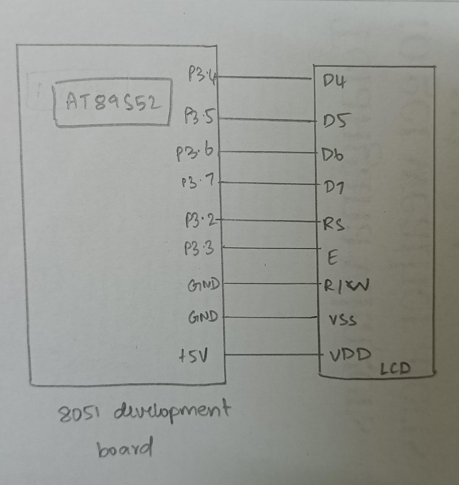

# CAT7 – Task 2: Cursor Positioning and Dynamic Value Update

| EXP | CAT7 |
|---|---|
| DATE | 24/08/2026 |
| NAME OF EXP | 16×2 LCD Driver Development and Dynamic Display Control |

## Hardware Setup / Platform

Development Board: 8051 Development Board  
Microcontroller: AT89S52  
Display: 16×2 HD44780-compatible Character LCD  
LCD Interface: 4-bit GPIO-based interface  
Data Pins: P3.4–P3.7  
Enable Pin (E): P3.3  
Register Select (RS): P3.2  
Programming Environment: Keil µVision  
Programming Language: Embedded C  

## Task No

Task 7B – Cursor Positioning and Dynamic Value Update

Develop reusable LCD driver functions for command and data transmission.

Implement cursor positioning using DDRAM addresses.

Display strings using lcd_puts().

Display integer values using lcd_print_number().

Update the LCD contents dynamically.

### Functions Implemented

| Function | Purpose |
|---|---|
| lcd_cmd() | Sends commands to the LCD. |
| lcd_data() | Sends character data to the LCD. |
| lcd_goto() | Positions the LCD cursor. |
| lcd_puts() | Displays a string. |
| lcd_print_number() | Displays an integer value. |
| lcd_init() | Initializes the LCD in 4-bit mode. |

## Circuit Diagram

Cursor Positioning and Dynamic Value Update



## Hardware Connections

| AT89S52 Pin | LCD Pin | Function |
|---|---|---|
| P3.4 | D4 | Data |
| P3.5 | D5 | Data |
| P3.6 | D6 | Data |
| P3.7 | D7 | Data |
| P3.3 | E | Enable |
| P3.2 | RS | Register Select |

The LCD also requires power, ground, contrast and RW connections according to the actual hardware setup.

## Core Logic / Pseudocode / Code Base

### LCD Configuration

| Command / Address | Value | Purpose |
|---|---|---|
| First Row | 0x00 | Starting DDRAM address |
| Second Row | 0x40 | Starting DDRAM address |
| Set DDRAM Address | 0x80 OR address | Positions the cursor |
| Display Control | 0x0F | Display ON, cursor ON and blinking ON |
| Entry Mode | 0x06 | Increments cursor position |
| Clear Display | 0x01 | Clears LCD contents |

### Working

**lcd_cmd():**

Sends the upper and lower command nibbles with RS LOW.

**lcd_data():**

Sends the upper and lower character nibbles with RS HIGH.

**lcd_goto():**

Calculates the DDRAM address based on the selected row and column.

**lcd_puts():**

Displays characters until the null terminator is reached. Moves to the second row when the position counter reaches 16.

**lcd_print_number():**

Extracts digits using modulus and division, then displays them in the correct order. Handles negative numbers using a minus sign.

**lcd_init():**

Configures the LCD for 4-bit communication and initializes display settings.

### Pseudocode

```text
START

INITIALIZE LCD

DEFINE lcd_cmd(command):
    Send upper nibble
    Send lower nibble

DEFINE lcd_data(character):
    Send upper nibble
    Send lower nibble
    Increment position counter

DEFINE lcd_goto(row, column):
    Calculate DDRAM address
    Send Set DDRAM Address command

DEFINE lcd_puts(string):
    Read characters until null terminator
    Display each character
    Move to second row when required

DEFINE lcd_print_number(number):
    Check whether number is negative
    Extract digits using modulus and division
    Display digits in correct order

REPEAT FOREVER:
    Display "LCD testing..."
    Clear display
    Reset position counter

    Display "Hello Dinesh Sir :)"
    Apply delay
    Clear display
    Reset position counter

END
```

### Key Observations

The LCD uses DDRAM addresses to identify character positions.

The first row starts at address 0x00.

The second row starts at address 0x40.

The Set DDRAM Address command is used for cursor positioning.

The lcd_puts() function displays strings character by character.

The lcd_print_number() function converts integer digits into displayable characters.

The main program displays two messages alternately.

### Implementation Observation

In the supplied lcd_init() function, lcd_nibble(0x03, 30) is called three times.

However, lcd_nibble() applies x & 0xF0, which results in zero for the argument 0x03. Therefore, these calls do not transmit the intended initialization nibble.

The intended 4-bit initialization sequence requires the initial 0x03 nibbles followed by the 0x02 nibble.

The lcd_print_number() function is defined but is not called in main().

The lcd_goto() function is used internally by lcd_puts() when the position counter reaches 16.

### Source Code

[TASK2.C](TASK2.C)

## Inference

The experiment demonstrates the development of reusable LCD driver functions using Embedded C.

It introduces DDRAM addressing for cursor positioning, string handling, integer-to-character conversion and dynamic display updates.

The experiment provides an understanding of how low-level LCD commands can be organized into reusable functions to simplify interaction between the microcontroller and the display.

