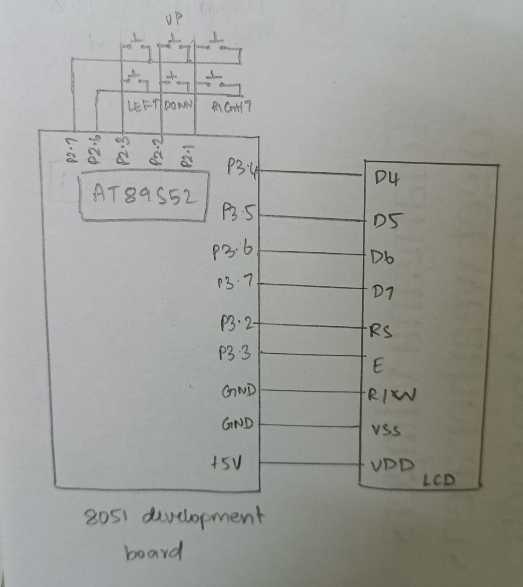

# CAT7 – Task 3: 4×4 Keypad-Based Character Movement

| EXP | CAT7 |
|---|---|
| DATE | 24/08/2026 |
| NAME OF EXP | 16×2 LCD Driver Development and Dynamic Display Control |

## Hardware Setup / Platform

Development Board: 8051 Development Board  
Microcontroller: AT89S52  
Display: 16×2 HD44780-compatible Character LCD  
Input Device: 4×4 Matrix Keypad  
LCD Interface: 4-bit GPIO-based interface  
LCD Data Pins: P3.4–P3.7  
LCD Enable Pin (E): P3.3  
LCD Register Select (RS): P3.2  
Keypad Row Pins: P2.7 and P2.6  
Keypad Direction Signal Pins: P2.2, P2.3 and P2.1  
Programming Environment: Keil µVision  
Programming Language: Embedded C  

## Task No

Task 7C – 4×4 Keypad-Based Character Movement

Interface a 4×4 matrix keypad with the AT89S52 microcontroller.

Initialize the 16×2 LCD in 4-bit mode.

Display the character A at the initial position (row 1, column 1).

Scan keypad inputs to identify directional commands.

Move the character according to the selected direction.

Maintain row and column boundaries to prevent movement outside the LCD.

### Keypad Direction Controls

| Key | Action |
|---|---|
| 2 | Move Up |
| 5 | Move Down |
| 4 | Move Left |
| 6 | Move Right |

## Circuit Diagram

4×4 Keypad-Based Character Movement



## Hardware Connections

### LCD Connections

| AT89S52 Pin | LCD Pin | Function |
|---|---|---|
| P3.4 | D4 | Data |
| P3.5 | D5 | Data |
| P3.6 | D6 | Data |
| P3.7 | D7 | Data |
| P3.3 | E | Enable |
| P3.2 | RS | Register Select |

### Keypad Connections Indicated in the Program

| AT89S52 Pin | Program Signal |
|---|---|
| P2.7 | ROW7 |
| P2.6 | ROW6 |
| P2.2 | UP and DOWN |
| P2.3 | LEFT |
| P2.1 | RIGHT |

The LCD and keypad must share a common ground with the development board. The actual keypad wiring should be verified against the laboratory circuit.

## Core Logic / Pseudocode / Code Base

### LCD Configuration

| Command / Address | Value | Purpose |
|---|---|---|
| Function Set | 0x28 | Selects 4-bit mode and 2-line operation |
| Display Control | 0x0F | Display ON, cursor ON and blinking ON |
| Entry Mode | 0x06 | Increments cursor position |
| Clear Display | 0x01 | Clears LCD contents |
| First Row | 0x00 | Starting DDRAM address |
| Second Row | 0x40 | Starting DDRAM address |

### Working

**LCD Initialization:**

Initializes the LCD in 4-bit mode.

**keypad_scan():**

Scans the configured keypad signals and returns a direction code.

**move_up():**

Erases the current character and moves it one row upward.

**move_down():**

Erases the current character and moves it one row downward.

**move_left():**

Erases the current character and moves it one column to the left.

**move_right():**

Erases the current character and moves it one column to the right.

**Main Function:**

Starts at row 1, column 1, displays A and continuously scans keypad inputs.

### Pseudocode

```text
START

INITIALIZE LCD

SET:
    row = 1
    col = 1

DISPLAY CHARACTER A

REPEAT FOREVER:

    Scan keypad

    IF UP key is detected:
        IF row > 1:
            Erase current character
            Decrement row
            Display A at new position

    ELSE IF DOWN key is detected:
        IF row < 2:
            Erase current character
            Increment row
            Display A at new position

    ELSE IF LEFT key is detected:
        IF col > 1:
            Erase current character
            Decrement col
            Display A at new position

    ELSE IF RIGHT key is detected:
        IF col < 16:
            Erase current character
            Increment col
            Display A at new position

END
```

### Key Observations

The program combines keypad input scanning with LCD character movement.

The current character position is maintained using row and col variables.

The lcd_goto() function uses DDRAM addresses to position the cursor.

The current character is erased before displaying it at the new position.

Boundary conditions restrict movement to two rows and sixteen columns.

Software delays are used for basic keypad debouncing.

### Implementation Observations

**UP and DOWN Pins:**

Both signals are assigned to P2.2. They cannot independently identify two directions as written.

**Key Identification:**

keypad_scan() returns abstract values 1, 2, 3 and 4. It does not explicitly identify the physical keypad key numbers 2, 5, 4 and 6.

**Matrix Scanning:**

The supplied code uses two row input pins and three direction signal pins. It does not implement a conventional scan of all four rows and four columns of a 4×4 matrix keypad.

**LCD Initialization:**

The lcd_nibble() function applies x & 0xF0. Consequently, the calls with 0x03 do not transmit the intended initialization nibble.

These details should be checked against the actual keypad wiring and the HD44780 initialization sequence.

### Source Code

[TASK3.C](TASK3.C)

## Inference

The experiment demonstrates the interfacing of a matrix keypad and a 16×2 LCD with the AT89S52 microcontroller.

It combines GPIO-based input scanning, software debouncing, LCD cursor positioning and character movement.

The program demonstrates how user input can be used to dynamically update the position of a character on an LCD while maintaining row and column boundary conditions.

