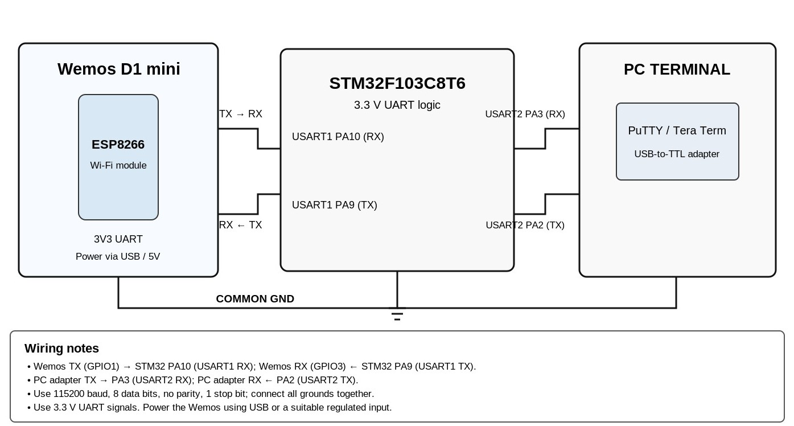

# CAT10 – Task 10A – STM32 ↔ Wemos UART Communication

| Field | Details |
|-------|---------|
| EXP | CAT10 |
| DATE | 05/10/2026 |
| NAME OF EXP | STM32–Wemos Wi-Fi Modem Interface Using AT Commands |
| HARDWARE SETUP / PLATFORM | STM32F103C8T6 Blue Pill (ARM Cortex-M3, 72 MHz), ST-Link V2, Wemos D1 Mini (ESP8266, AT firmware), USB-to-TTL serial adapter, STM32CubeMX + Keil MDK-ARM (HAL), PuTTY / Tera Term |
| TASK NO | Task 10A – STM32 ↔ Wemos UART Communication |

## 1. Objective

Before attempting Wi-Fi, prove that the two boards can communicate. Configure a UART connection between the STM32 and the Wemos, transmit the command `AT` followed by CR/LF from the STM32, and receive and display the Wemos response on the PC terminal.

## 2. Circuit Diagram



**Pin Connections:**

| Wemos D1 Mini Pin | STM32 Pin | Description |
|-------------------|-----------|-------------|
| TX | RX (e.g. PA3 / USART2_RX) | Data from Wemos to STM32 |
| RX | TX (e.g. PA2 / USART2_TX) | Data from STM32 to Wemos |
| GND | GND | Common ground reference |
| 5V / 3.3V | 5V / 3.3V | Appropriate power source |

Expected data flow:

```
STM32 TX  ---------->  Wemos RX
STM32 RX  <----------  Wemos TX
   |
   | UART to PC
   v
PuTTY / Tera Term
```

## 3. Core Logic / Pseudocode / Code Base

**Working Principle:**

The STM32 sends the text `AT\r\n` to the ESP8266. A working modem replies `OK\r\n`. The STM32 receives these characters (`'O'`, `'K'`, `'\r'`, `'\n'`) on its UART RX pin and forwards them to the PC terminal so the student can see the response.

**Pseudocode:**

1. Initialise HAL, system clock and the UART(s).
2. Print a banner (`STM32-WiFi MODEM TEST`) to the PC terminal.
3. Transmit `"AT\r\n"` to the Wemos with `HAL_UART_Transmit()`.
4. Receive the response with `HAL_UART_Receive()` (with a timeout).
5. Forward the received bytes to the PC terminal and print `>> AT` / `<< OK`.

**Code Base:**

Uses `HAL_UART_Transmit()` and `HAL_UART_Receive()` in polling mode. If the board supports it, one UART talks to the Wemos and a second UART talks to the PC.

## 4. Inference

**Observation:**

The PC terminal displayed `>> AT` followed by `<< OK`, showing that the Wemos received the command and answered.

**Conclusion:**

A correct `OK` reply confirms matching baud rate, correct TX/RX cross-wiring, common ground and working AT firmware, so the link is ready for Wi-Fi commands. No reply usually points to swapped TX/RX, a missing common ground or a baud-rate mismatch.
