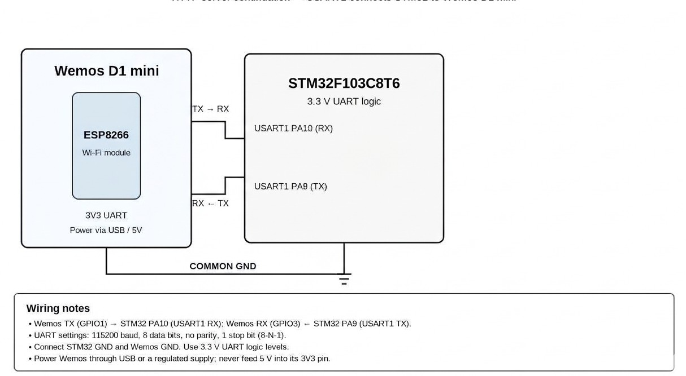

# CAT11 – HTTP Server on STM32 using ESP8266/Wemos (AT Commands)

| Field | Details |
|-------|---------|
| Course | 25CS2741 Fundamentals of Internet of Things + Lab |
| Institute | Shiv Nadar University – Chennai, Dept. of Computer Science |
| DATE | 12/10/2026 |
| Platform | STM32 development board, STM32CubeMX + Keil MDK-ARM (HAL), ESP8266 / Wemos D1 Wi-Fi module, Node-RED |

## Problem Statement

Develop an STM32-based HTTP sensor node in which the STM32 communicates with an ESP8266/Wemos over UART using AT commands, configures the ESP8266 as a TCP server, receives an HTTP request through an `+IPD` frame, constructs an HTTP response and transmits it to a browser and to Node-RED.


| Folder | Task | Summary |
|--------|------|---------|
| [`TASKA`](TASKA/README.md) | 11A (with 10D) | Configure the ESP8266 as a TCP server (`AT+CIPMUX=1`, `AT+CIPSERVER=1,80`), observe the `+IPD` request, reply with an HTTP response using the two-step `AT+CIPSEND`. |
| [`TASKB`](TASKB/README.md) | 11B | Use Node-RED (Inject → HTTP request → Debug) as a second client that fetches the page served by the STM32/ESP8266. |

## Overall Architecture

```
Browser / Node-RED
      │  HTTP GET /
      ▼
   ESP8266  ──(+IPD frame, UART)──►  STM32
      ▲                                 │ builds HTTP response
      └──── AT+CIPSEND=<id>,<len> ◄─────┘
            then response bytes
```



## Overall Inference

The STM32 never touches TCP directly; the ESP8266 handles Wi-Fi and TCP while the STM32 parses `+IPD` frames and builds the HTTP response as a plain string. The same server answers both a web browser (Task A) and an automation client, Node-RED (Task B), showing that a standard HTTP client can talk to a microcontroller node.
