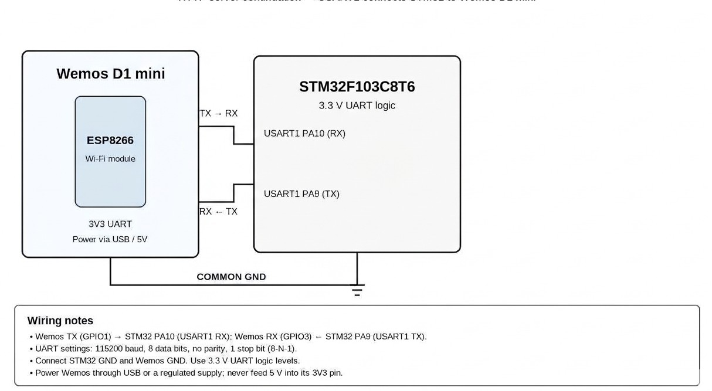

# Task 11A – Configure ESP8266 as a TCP Server (with 11A: Observe Request & Send Response)

| Field | Details |
|-------|---------|
| EXP | CAT11 – Task A |
| DATE | 12/10/2026 |
| HARDWARE / PLATFORM | STM32 board, STM32CubeMX + Keil MDK-ARM (HAL), ESP8266 / Wemos D1 Wi-Fi module (UART, AT commands), web browser |

## 1. Objective

Configure the ESP8266 as a TCP server from the STM32 using AT commands, capture the browser's HTTP request as an `+IPD` frame, and reply with a valid static HTTP response using the two-step `AT+CIPSEND`.

## 2. Circuit Diagram



| Signal | Connection | Description |
|--------|------------|-------------|
| 3.3 V / GND | 3V3 / GND | Supply to ESP8266 (common ground) |
| ESP8266 TX | STM32 USART RX | Data from ESP8266 to STM32 |
| ESP8266 RX | STM32 USART TX | Data from STM32 to ESP8266 |

> Update the USART number and pins to match your CubeMX configuration.

## 3. Core Logic

**Server configuration (AT commands):**

```
AT
AT+CIPMUX=1
AT+CIPSERVER=1,80
```

| Command | Purpose |
|---------|---------|
| `AT` | Check the module responds with `OK` |
| `AT+CIPMUX=1` | Enable multiple connections (required for server mode) |
| `AT+CIPSERVER=1,80` | Start a TCP server on port 80 |

**Task 10D – observe the request.** When the browser opens `http://<ESP8266_IP>/`, the ESP8266 sends an `+IPD` notification to the STM32:

```
+IPD,0,XXX:GET / HTTP/1.1
Host: 192.168.1.105
...
```

`0` is the link ID and `XXX` the number of received bytes.

**Static HTTP response structure:** status line, headers, blank line, HTML body.

```
HTTP/1.1 200 OK
Content-Type: text/html
Content-Length: <body_length>

<html><body><h1>STM32 IoT Node</h1><p>Hello from STM32</p></body></html>
```

**Sending the response – `AT+CIPSEND` split into two steps:**

1. Step 1 – send the command, then wait for the `>` prompt:
   ```c
   sprintf(cmd, "AT+CIPSEND=%d,%d\r\n", link_id, data_length);
   ```
2. Step 2 – build and send the response string:
   ```c
   sprintf(response,
       "HTTP/1.1 200 OK\r\n"
       "Content-Type: text/html\r\n"
       "Content-Length: %d\r\n"
       "\r\n"
       "<html><body><h1>STM32 IoT Node</h1></body></html>",
       body_length);
   ```

**Pseudocode:**

1. Initialise HAL, clock, GPIO and the UART connected to the ESP8266.
2. Send `AT`, `AT+CIPMUX=1`, `AT+CIPSERVER=1,80` and check each `OK`.
3. Wait for `+IPD`; parse the link ID and check for `GET /`.
4. Compute `body_length`, then `data_length` = full response length (headers + body).
5. Send `AT+CIPSEND=<link_id>,<data_length>`; wait for `>`.
6. Transmit the response string; wait for `SEND OK`.
7. Close the link (`AT+CIPCLOSE=<link_id>`) and go back to step 3.


## 4. Inference

**Observation:**

The ESP8266 accepted the server commands with `OK`. Opening the module's IP in a browser produced an `+IPD,0,...:GET / HTTP/1.1` frame on the STM32, and the browser displayed the "STM32 IoT Node" page.

**Conclusion:**

The STM32 can act as an HTTP server through the ESP8266 using only AT commands. `Content-Length` and the `AT+CIPSEND` length must match the real byte counts, and the `>` prompt must be received before the response is sent.