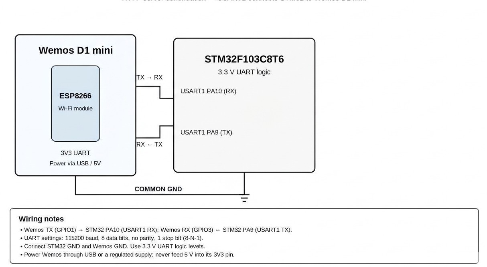

# Task 11B – Node-RED as a Second HTTP Client of the STM32/ESP8266 HTTP Server

| Field | Details |
|-------|---------|
| EXP | CAT11 – Task B  |
| DATE | 12/10/2026 |
| HARDWARE / PLATFORM | STM32 + ESP8266/Wemos D1 HTTP server from Task A, Node-RED (same Wi-Fi network) |

## 1. Objective

Use Node-RED as a second HTTP client that requests the page served by the STM32/ESP8266 and displays the response.

## 2. Circuit / Flow Diagram

Hardware is the same as Task A:

 

```
[ Inject ] ──► [ HTTP request ] ──► [ Debug ]
```

## 3. Core Logic

**Node-RED flow:**

1. **Inject** node – configured to trigger the request (click, or repeat at an interval).
2. **HTTP request** node – method `GET`, URL:
   ```
   http://<ESP8266_IP>/
   ```
   Return: *a UTF-8 string*.
3. **Debug** node – shows `msg.payload`, the HTTP response from the STM32.

**Steps:**

1. Run the Task A firmware so the TCP server is listening on port 80.
2. Note the ESP8266 IP and make sure the PC running Node-RED is on the same network.
3. Build the flow, enter the IP in the HTTP request node, deploy.
4. Click the Inject button and read the debug sidebar.


## 4. Inference

**Observation:**

On each inject, Node-RED sent `GET /` to the ESP8266, the STM32 received the `+IPD` frame, and the debug node showed `<html><body><h1>STM32 IoT Node</h1>...</body></html>`.

**Conclusion:**

The STM32/ESP8266 node behaves as a standard HTTP server, so both a browser and Node-RED can use it. This is the base for connecting embedded nodes to automation and analytics flows.
