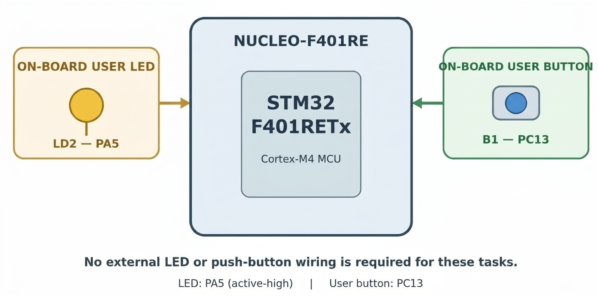

# CAT12 – Task 12C – Short-Press and Long-Press Detection

| Field | Details |
|-------|---------|
| EXP | CAT12 |
| DATE | 14/10/2026 |
| NAME OF EXP | STM32F401RE Cortex-M4: GPIO and User Input Programming |
| HARDWARE SETUP / PLATFORM | STM32 NUCLEO-F401RE (STM32F401RET6, ARM Cortex-M4, up to 84 MHz), on-board ST-LINK/V2-1, STM32CubeMX + Keil MDK-ARM (HAL) |
| TASK NO | Task 12C – Short-Press and Long-Press Detection |

## 1. Objective

Extend the application to distinguish between a short button press and a long button press. The STM32 performs a different action depending on the duration of the press: a short press (< 1 s) toggles the LED and a long press (≥ 1 s) puts the LED in continuous blinking mode.

## 2. Circuit Diagram

**Pin Connections:**

| Signal / Component | MCU Pin | Description |
|--------------------|---------|-------------|
| Power / programming | USB (ST-LINK) | Board supply and debug link over the on-board ST-LINK |
| System clock | HSE (8 MHz from ST-LINK) or HSI → PLL | Configured in CubeMX |
| LED (LD2) | PA5 | Output (on-board user LED, active-HIGH) |
| User button (B1) | PC13 | Input (on-board, external pull-up; reads LOW when pressed) |

## 3. Core Logic / Pseudocode / Code Base

**Working Principle:**

The press duration is measured with the HAL millisecond tick: the start time is recorded when the button is pressed and the duration is calculated when it is released. Blinking is also timed with `HAL_GetTick()`, so the program never blocks while the button is held.

**Pseudocode:**

1. On press: `start = HAL_GetTick()` (after a ~50 ms debounce).
2. On release: `duration = HAL_GetTick() − start`.
3. If `duration < 1000`: if blinking → stop blinking, else toggle the LED.
4. If `duration ≥ 1000`: enter blinking mode.
5. Blinking mode: if `HAL_GetTick() − last ≥ 250`, toggle the LED and update `last`.
6. Repeat continuously.

**Code Base:**

Uses `HAL_GPIO_ReadPin()`, `HAL_GPIO_TogglePin()`, `HAL_GPIO_WritePin()` and `HAL_GetTick()`; `HAL_Delay()` is not used for press detection.

| User Action | System Response |
|-------------|-----------------|
| Short press (< 1 s) | Toggle LED |
| Long press (≥ 1 s) | LED enters continuous blinking mode |
| Next short press | Stop blinking |

## 4. Inference

**Observation:**

Short presses toggled the LED, a long press started blinking, and a short press during blinking stopped it. The button stayed responsive in every state.

**Conclusion:**

Measuring press duration with the non-blocking `HAL_GetTick()` timer allows one button to trigger different actions while the rest of the firmware keeps running.
