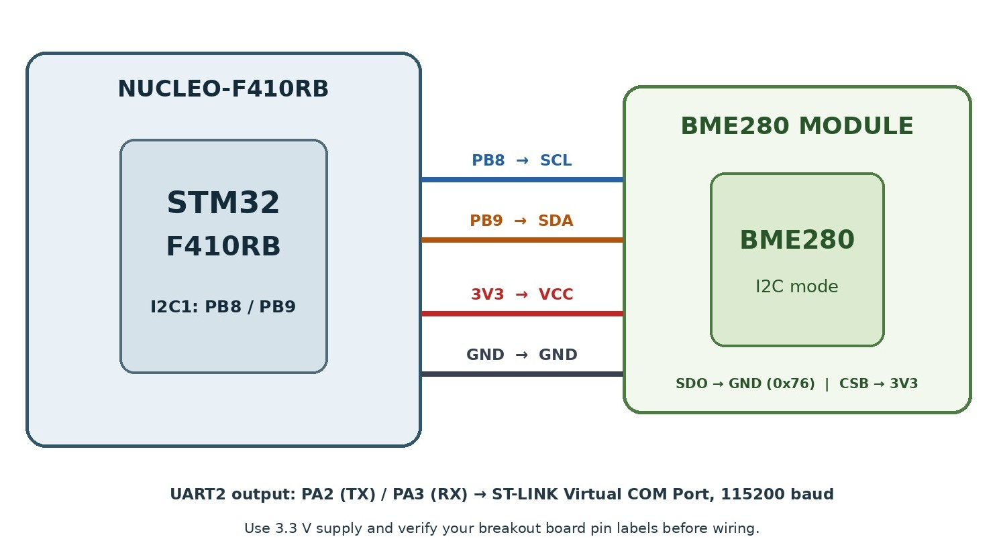

# CAT13 – BME280 Sensor Interfacing Using I²C and Bosch Sensor API

| Field | Details |
|-------|---------|
| EXP | CAT13 |
| DATE | 23/10/2026 |
| NAME OF EXP | BME280 Sensor Interfacing Using I²C and Bosch Sensor API |
| HARDWARE SETUP / PLATFORM | NUCLEO-F401RE (STM32F401RE, ARM Cortex-M4F, up to 84 MHz), on-board ST-Link, STM32CubeMX + Keil MDK-ARM (HAL), BME280 sensor (I²C), ESP8266 Wi-Fi module |
| TASK NO | Single task – Sensor Interfacing (BME280) – STM32 (Debug) – ESP8266 (Wi-Fi) HTTP |

## 1. Objective

Develop an STM32-based environmental sensing application that interfaces a BME280 sensor over I²C and obtains compensated temperature, pressure and humidity using the official Bosch Sensortec BME280 Sensor API (`BoschSensortec/BME280_SensorAPI`), without rewriting the compensation equations. Display the values on the UART terminal for debugging, then serve them over Wi-Fi through the ESP8266 as a raw HTTP response with a JSON body, whose `Content-Length` is calculated from the actual JSON string length.

## 2. Circuit Diagram



**Pin Connections:**

| Signal / Component | MCU Pin | Description |
|--------------------|---------|-------------|
| 3.3 V / GND | 3V3 / GND | Supply for BME280 and ESP8266 (common ground) |
| HSE / system clock | ST-Link MCO (8 MHz) or HSI → PLL | Configured in CubeMX (up to 84 MHz) |
| BME280 SCL | PB8 (I2C1_SCL) | I²C clock |
| BME280 SDA | PB9 (I2C1_SDA) | I²C data |
| BME280 SDO | GND | Address 0x76 (3.3 V gives 0x77) |
| ESP8266 TX | PA10 (USART1_RX) | Data from ESP8266 to STM32 |
| ESP8266 RX | PA9 (USART1_TX) | Data from STM32 to ESP8266 |
| Debug terminal | USART2 (ST-Link virtual COM port) | Output to PC terminal |

## 3. Core Logic / Pseudocode / Code Base

**Working Principle:**

The Bosch driver is hardware independent: it reaches the sensor only through three STM32-specific functions (`read_register`, `write_register`, `delay`) that are hooked into the `bme280_dev` structure. `bme280_init()` resets the sensor and loads the trim data; `bme280_get_sensor_data()` reads the raw registers and applies the Bosch compensation. The compensated values are printed on UART and formatted as JSON for the HTTP response sent through the ESP8266.

**Driver setup:**

1. Copy `bme280.c` to `Core/Src`, and `bme280.h` and `bme280_defs.h` to `Core/Inc`.
2. Add `bme280.c` to the `Application/User/Core` group in Keil and make sure `..\Core\Inc` is in *Options for Target → C/C++ → Include Paths*.

**Pseudocode:**

1. Initialise HAL, clock, GPIO, I²C1 and the UARTs.
2. Hardware wrappers return `BME280_OK` or `BME280_E_COMM_FAIL`:
   - `user_i2c_read()` → `HAL_I2C_Mem_Read(&hi2c1, dev_addr << 1, reg, I2C_MEMADD_SIZE_8BIT, data, len, HAL_MAX_DELAY)`
   - `user_i2c_write()` → `HAL_I2C_Mem_Write(...)`
   - `user_delay_us()` → `HAL_Delay(period / 1000 + 1)`
3. Set `dev.intf_ptr = &dev_addr` (0x76), `dev.intf = BME280_I2C_INTF`, `dev.read`, `dev.write`, `dev.delay_us`.
4. Read the chip ID (register `0xD0`) and check it is `0x60`; halt or report an error if not.
5. `bme280_init(&dev)`, then set `osr_t`, `osr_p`, `osr_h` (oversampling) and the filter with `bme280_set_sensor_settings()`, and start continuous measurement with `bme280_set_sensor_mode(BME280_MODE_NORMAL, &dev)`.
6. In `while(1)`: `bme280_get_sensor_data(BME280_ALL, &comp_data, &dev)`; if `BME280_OK`, take `temperature` (°C), `pressure / 100.0f` (hPa) and `humidity` (%RH), print them, then `HAL_Delay(1000)`.
7. Build the JSON body with `snprintf()`, compute `Content-Length = strlen(json)`, and assemble the HTTP response.
8. With the ESP8266 in station mode and running a TCP server, send the response to the browser with `AT+CIPSEND=<id>,<total_length>`, followed by `AT+CIPCLOSE=<id>`.

**UART output:**

```
Temperature : XX.XX °C
Pressure    : XXXX.XX hPa
Humidity    : XX.XX %RH
```

**HTTP response (example):**

```
HTTP/1.1 200 OK
Content-Type: application/json
Content-Length: <calculated_length>

{"status":"success","temperature":28.45,"humidity":62.30,"pressure":1008.72}
```

Each header line ends with `\r\n` and a blank line separates the headers from the body. The browser shows:

```json
{
  "status": "success",
  "temperature": 28.45,
  "humidity": 62.30,
  "pressure": 1008.72
}
```

**Code Base:**

Uses `bme280_init()`, `bme280_set_sensor_settings()`, `bme280_set_sensor_mode()`, `bme280_get_sensor_data()`, `HAL_I2C_Mem_Read()` / `HAL_I2C_Mem_Write()`, `HAL_UART_Transmit()` / `HAL_UART_Receive()`, `snprintf()` and `strlen()`. Use placeholder Wi-Fi credentials before pushing to GitHub.

## 4. Inference

**Observation:**

I²C communication was established and the chip ID read back as `0x60`. The Bosch API initialised and configured the sensor successfully, and valid temperature, pressure and humidity values were printed over UART and changed when the sensor environment changed. The browser received the JSON object with the same three values.

**Conclusion:**

The Bosch driver gives compensated readings without hand-written equations, and only three wrapper functions are needed to port it to the STM32. Calculating `Content-Length` from the actual JSON length lets the browser read the whole body, so the STM32 can serve live sensor data over HTTP through the ESP8266.
