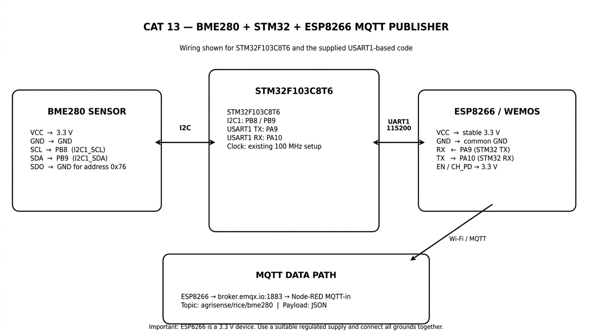

# CAT14 – BME280 Sensor Interfacing Using I²C and MQTT (Custom ESP8266 API)

| Field | Details |
|-------|---------|
| EXP | CAT14 |
| DATE | 27/10/2026 |
| NAME OF EXP | BME280 Sensor Interfacing Using I²C and MQTT Using Custom Built ESP8266 API |
| HARDWARE SETUP / PLATFORM | NUCLEO-F401RE (STM32F401RE, ARM Cortex-M4F, up to 84 MHz), on-board ST-Link, STM32CubeMX + Keil MDK-ARM (HAL), BME280 sensor (I²C), ESP8266 Wi-Fi module, custom ESP8266/MQTT library (`ESPLib.c` / `ESPLib.h`), MQTT broker, Node-RED |
| TASK NO | Single task – Sensor Interfacing (BME280) – MQTT – Node Analytics |

## 1. Objective

As a continuation of CAT13, develop an STM32-based environmental sensing application that reads compensated temperature, pressure and humidity from a BME280 over I²C and sends them as JSON to Node-RED for analytics using MQTT. The custom ESP8266 library is used to connect to Wi-Fi and the MQTT broker, and Node-RED's `mqtt in` node receives and visualises the three parameters.

## 2. Circuit Diagram

<<<<<<< HEAD

**Pin Connections:**

| Signal / Component | MCU Pin | Description |
|--------------------|---------|-------------|
| 3.3 V / GND | 3V3 / GND | Supply for BME280 and ESP8266 (common ground) |
| HSE / system clock | ST-Link MCO (8 MHz) or HSI → PLL | Configured in CubeMX (up to 84 MHz) |
| BME280 SCL | PB8 (I2C1_SCL) | I²C clock |
| BME280 SDA | PB9 (I2C1_SDA) | I²C data |
| ESP8266 TX | PA3 (USART2_RX) | Data from ESP8266 to STM32 |
| ESP8266 RX | PA2 (USART2_TX) | Data from STM32 to ESP8266 |

The ESP8266 library is initialised on `huart2` (USART2), as in the lab sheet.

## 3. Core Logic / Pseudocode / Code Base

**Working Principle:**

The library hides the AT commands: it puts the ESP8266 in station mode, joins Wi-Fi, opens a TCP socket to the broker on port 1883 and speaks MQTT over it. The STM32 reads the BME280 through the Bosch API (CAT13), builds a JSON string from the compensated values and publishes it on a topic. Node-RED subscribes to the same topic on the same broker, parses the JSON and shows temperature, humidity and pressure.

**Driver setup:**

1. Add `ESPLib.c` (→ `Core/Src`) and `ESPLib.h` (→ `Core/Inc`) to the Keil project, with `..\Core\Inc` in the include paths.
2. Keep the Bosch `bme280.c`, `bme280.h`, `bme280_defs.h` files from CAT13.

**Pseudocode:**

1. Initialise HAL, clock, GPIO, I²C1 and USART2; initialise and configure the BME280 as in CAT13.
2. `ESP8266_Init(StationMode, huart2)`.
3. `ESP8266_wifiConnect("<SSID>", "<password>")`.
4. `ESP8266_portConnect("TCP", "<broker>", "1883")` (for example `broker.emqx.io`).
5. Fill `MQTT_InitTypeDef_t mqttSetting` (`keepAlive = 500`, `connectFlag = CleanSession`, `clientID`) and call `MQTT_connectBroker(&mqttSetting)`.
6. In `SysTick_Handler()`, call `MQTTTimer()` before `HAL_IncTick()`.
7. In `while(1)`:
   - `bme280_get_sensor_data(BME280_ALL, &comp_data, &dev)`.
   - Build the JSON with `snprintf()`: `{"status":"success","temperature":28.45,"humidity":62.30,"pressure":1008.72}`.
   - `MQTT_publishTopic("<topic>", json, QoS0)`.
   - `HAL_Delay(1000)`.

**Node-RED flow:**

1. Add an **mqtt in** node (Network category) and set the broker (server, port 1883) and the same topic the STM32 publishes to.
2. Set the output to *a parsed JSON object*.
3. Connect it to a **debug** node (and optionally gauge/chart nodes) to show `msg.payload.temperature`, `msg.payload.humidity` and `msg.payload.pressure`.

Reference: EMQX blog, *Using Node-RED to Process MQTT Data*.

**Code Base:**

Uses `ESP8266_Init()`, `ESP8266_wifiConnect()`, `ESP8266_portConnect()`, `MQTT_connectBroker()`, `MQTT_publishTopic()`, `MQTTTimer()`, the Bosch API calls from CAT13 and `snprintf()`. The SSID, password and broker are placeholders; do not commit real credentials.

## 4. Inference

**Observation:**

The STM32 connected to Wi-Fi and the MQTT broker, and the JSON object with `status`, `temperature`, `humidity` and `pressure` appeared in Node-RED about once per second. The values changed as the sensor environment changed.

**Conclusion:**

MQTT publish/subscribe decouples the STM32 from the analytics side: the device only publishes to a topic, and Node-RED can receive, parse and visualise the BME280 data. The custom ESP8266 library lets the application use Wi-Fi and MQTT through a few high-level function calls.
