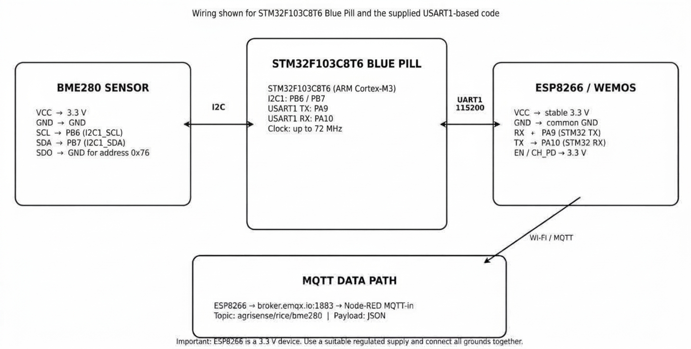
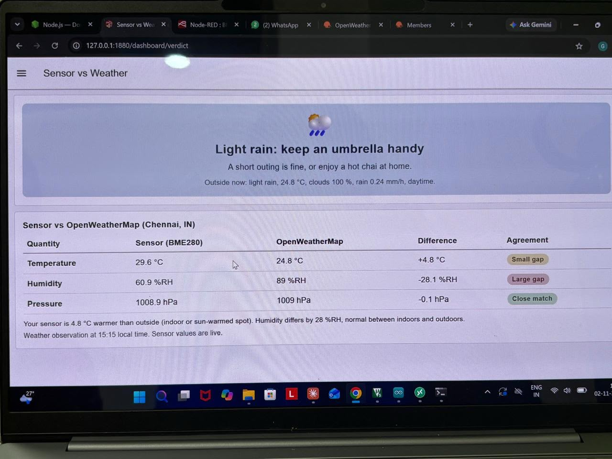

# CAT15(PROJECT) – BME280 Sensor Dashboard in Node-RED using STM32 Blue Pill, I²C and MQTT

| Field | Details |
|-------|---------|
| EXP | CAT15 |
| DATE | <02/11/2026> |
| NAME OF EXP | BME280 Sensor Interfacing on Blue Pill with MQTT and a Node-RED Dashboard |
| HARDWARE SETUP / PLATFORM | STM32 Blue Pill (STM32F103C8T6, ARM Cortex-M3, up to 72 MHz), ST-Link V2 programmer, STM32CubeMX + Keil MDK-ARM (HAL), BME280 sensor (I²C), ESP8266 Wi-Fi module, custom ESP8266/MQTT library (`ESPLib.c` / `ESPLib.h`), MQTT broker, Node-RED with Node-RED Dashboard |
| TASK NO | Single task – Blue Pill – BME280 – MQTT – Node-RED Dashboard |

## 1. Objective

As a continuation of CAT14, port the BME280 + MQTT application from the NUCLEO-F401RE to the STM32 **Blue Pill**, and build a **Node-RED dashboard** that shows live temperature, humidity and pressure published by the device as JSON over MQTT.

## 2. Circuit Diagram



**Pin Connections:**

| Signal / Component | MCU Pin | Description |
|--------------------|---------|-------------|
| 3.3 V / GND | 3V3 / GND | Supply for BME280 and ESP8266 (common ground) |
| System clock | HSE 8 MHz → PLL | Configured in CubeMX (up to 72 MHz) |
| BME280 SCL | PB6 (I2C1_SCL) | I²C clock |
| BME280 SDA | PB7 (I2C1_SDA) | I²C data |
| ESP8266 TX | PA10 (USART1_RX) | Data from ESP8266 to Blue Pill |
| ESP8266 RX | PA9 (USART1_TX) | Data from Blue Pill to ESP8266 |
| Programming | ST-Link V2 → SWDIO / SWCLK / GND / 3V3 | Flashing and debugging |

The ESP8266 library is initialised on `huart1` (USART1). Update the pins/UART if your wiring differs.


## 3. Core Logic / Pseudocode / Code Base

**Working Principle:**

The custom library hides the AT commands: it puts the ESP8266 in station mode, joins Wi-Fi, opens a TCP socket to the broker on port 1883 and speaks MQTT over it. The Blue Pill reads the BME280 through the Bosch API, builds a JSON string from the compensated values and publishes it on a topic. Node-RED subscribes to the same topic, parses the JSON and feeds dashboard widgets that update live in the browser.

**Driver setup:**

1. Add `ESPLib.c` (→ `Core/Src`) and `ESPLib.h` (→ `Core/Inc`) to the Keil project, with `..\Core\Inc` in the include paths.
2. Keep the Bosch `bme280.c`, `bme280.h`, `bme280_defs.h` files from CAT13/CAT14, with the I²C read/write/delay callbacks using `hi2c1`.

**Pseudocode:**

1. Initialise HAL, clock, GPIO, I²C1 and USART1; initialise and configure the BME280.
2. `ESP8266_Init(StationMode, huart1)`.
3. `ESP8266_wifiConnect("<SSID>", "<password>")`.
4. `ESP8266_portConnect("TCP", "<broker>", "1883")` (for example `broker.emqx.io`).
5. Fill `MQTT_InitTypeDef_t mqttSetting` (`keepAlive = 500`, `connectFlag = CleanSession`, `clientID`) and call `MQTT_connectBroker(&mqttSetting)`.
6. In `SysTick_Handler()`, call `MQTTTimer()` before `HAL_IncTick()`.
7. In `while(1)`:
   - `bme280_get_sensor_data(BME280_ALL, &comp_data, &dev)`.
   - Build the JSON with `snprintf()`: `{"status":"success","temperature":28.45,"humidity":62.30,"pressure":1008.72}`.
   - `MQTT_publishTopic("<topic>", json, QoS0)`.
   - `HAL_Delay(1000)`.

**Node-RED dashboard flow:**

1. Install the dashboard nodes: *Manage palette → Install → `node-red-dashboard`*.
2. Add an **mqtt in** node, set the broker (server, port 1883) and the same topic the Blue Pill publishes to; output *a parsed JSON object*.
3. Add three **change** (or **function**) nodes that set `msg.payload` to `msg.payload.temperature`, `msg.payload.humidity` and `msg.payload.pressure`.
4. Connect each to dashboard widgets:
   - **gauge** nodes – temperature (°C), humidity (%), pressure (hPa).
   - **chart** nodes – line charts showing the trend of each parameter.
5. Create a dashboard **tab** and **group** (e.g. "BME280 Environment"), then *Deploy*.
6. Open the dashboard at `http://<node-red-host>:1880/ui`.

```
[ mqtt in ] ──┬─► [ temperature ] ──► [ gauge ] / [ chart ]
              ├─► [ humidity    ] ──► [ gauge ] / [ chart ]
              └─► [ pressure    ] ──► [ gauge ] / [ chart ]
```




**Code Base:**

Uses `ESP8266_Init()`, `ESP8266_wifiConnect()`, `ESP8266_portConnect()`, `MQTT_connectBroker()`, `MQTT_publishTopic()`, `MQTTTimer()`, the Bosch BME280 API calls and `snprintf()`. The SSID, password and broker are placeholders; do not commit real credentials.

## 4. Inference

**Observation:**

The Blue Pill connected to Wi-Fi and the MQTT broker, and the JSON object with `status`, `temperature`, `humidity` and `pressure` reached Node-RED about once per second. The dashboard gauges and charts updated live and followed changes in the sensor's surroundings.

**Conclusion:**

The same ESP8266/MQTT library and BME280 code ran on a low-cost Blue Pill with only pin and UART changes. MQTT publish/subscribe keeps the device independent of the visualisation side, and the Node-RED dashboard turns the raw JSON into a live monitoring view without extra code on the microcontroller.